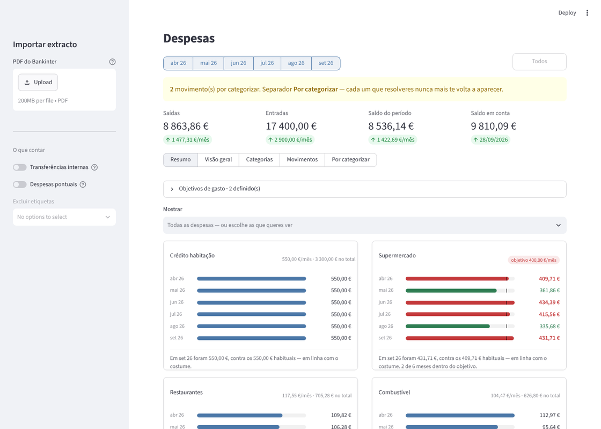
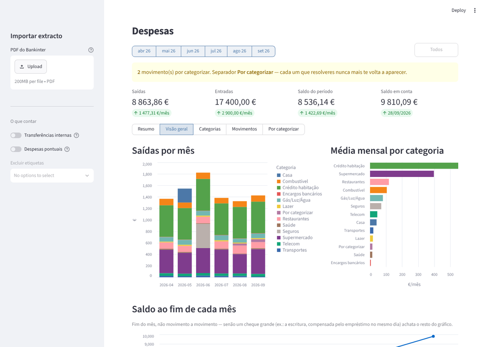
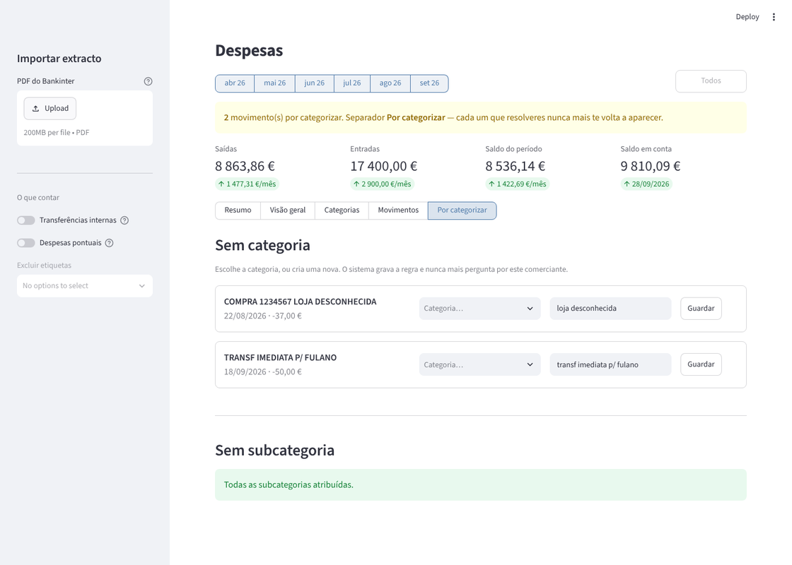
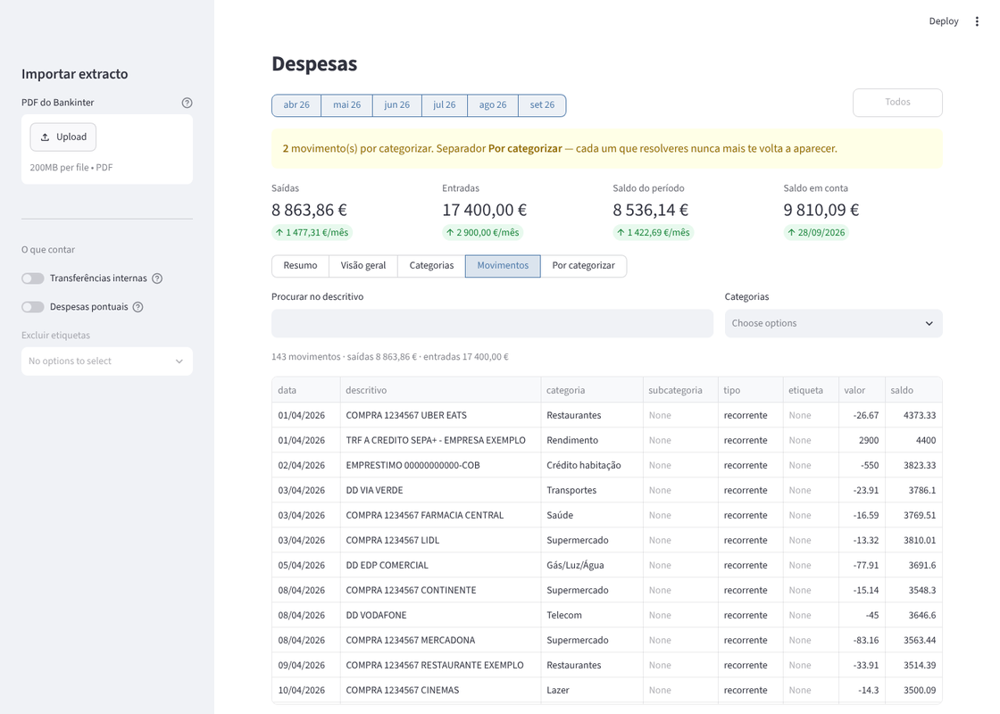
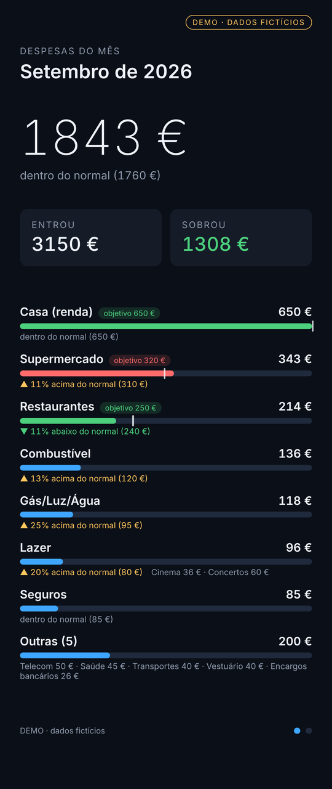

# Despesas do casal

Dashboard local de despesas domésticas, feito em Python com Streamlit e SQLite.
Metes os extractos do banco em PDF, o sistema extrai os movimentos, valida-os
pelos saldos ao cêntimo, categoriza-os por regras que aprendem com um clique, e
mostra tudo num dashboard que só corre na tua máquina.

<p align="center">
  
  
  
  
</p>

> As capturas usam a base de dados de demonstração (`src/demo.py`): movimentos e valores inventados.

Faz parte do [Super Monitor](https://github.com/LimeWolf9/super-monitor): o
`src/exportar_monitor.py` gera um resumo só com totais (sem movimentos nem
saldo) que aparece no monitor da parede.

<p align="center"></p>

---

## Experimentar com dados inventados

```bash
pip install -r requirements.txt
python src/demo.py                                 # cria data/demo.db
DESPESAS_DB=data/demo.db streamlit run app.py      # Windows: set DESPESAS_DB=data\demo.db
```

---

## Arrancar

```bash
pip install -r requirements.txt
streamlit run app.py
```

Abre em http://localhost:8501.

Com Docker:

```bash
docker compose up -d --build
```

---

## Como funciona

```
PDF  ──►  parser.py  ──►  categorizador.py  ──►  SQLite  ──►  app.py
          (valida           (regras YAML)        (dedup)      (dashboard)
           saldos)
```

### 1. Parser — valida-se a si próprio

Os extractos do Bankinter têm layout fixo, por isso o parsing é determinístico.
A parte importante não é extrair; é **provar que extraiu bem**.

Depois de ler as linhas, o parser confirma duas coisas:

1. `saldo_abertura + soma(movimentos) == saldo_fecho`
2. a coluna Saldo, movimento a movimento

Se alguma falhar, levanta `ErroDeParsing` e **não importa nada desse ficheiro**.
Nada de meio-extracto na base de dados.

Isto não é teoria: o primeiro teste falhou por uns euros porque o filtro de rodapé
("Pag. 2 de 4") estava a comer a linha "Pag. servico" do gás. Sem a validação,
esse erro tinha passado despercebido e as médias ficavam erradas para sempre.

### 2. Categorização — regras, não ML

`config/categorias.yaml`. Substring matching, primeira regra que bate ganha.

```yaml
Supermercado:
  - mercadona
  - continente
```

Porque regras e não um modelo: `norma decoracao` é loja de casa,
`norma lda` é restaurante. Uma regra distingue; um modelo treinado em poucas
centenas de movimentos provavelmente não.

**O que não bate em nada vai para a fila "Por categorizar"** no dashboard.
Escolhes a categoria, carregas em Guardar, e a app **escreve a regra de volta
no YAML** e recategoriza o histórico. Nunca mais te pergunta pelo mesmo
comerciante. É isto que faz o trabalho mensal tender para zero — sem este
ciclo, ao terceiro mês estarias a editar YAML à mão e abandonavas.

Na prática, a cobertura passa dos 95 % ao fim de poucos meses. O que sobra são
sobretudo transferências de pessoas, que só tu sabes o que são.

### 3. Categoria ≠ viagem

Uma viagem foi o caso que obrigou a uma decisão de desenho:
o jantar fora durante a viagem é **Restaurantes**, não "Viagem" — senão a
categoria Restaurantes mente sobre o teu padrão normal.

Por isso há dois eixos separados:

- **categoria** — o que é (vem do comerciante)
- **etiqueta** — a que episódio pertence (pões tu: `Férias verão/26`)

No dashboard excluis a etiqueta e as médias ficam limpas, sem perder a despesa.

Além disso cada categoria tem um **tipo**: `recorrente`, `pontual`
(compra da casa, alojamento) ou `interno` (transferências tuas entre contas). Os toggles da barra lateral ligam e desligam cada um.

### 4. SQLite com deduplicação

Chave primária = hash de `data + descritivo + valor + saldo`.

Podes reimportar o mesmo extracto as vezes que quiseres — e vais, por engano.
O saldo entra no hash de propósito: duas devoluções iguais no mesmo
dia são movimentos distintos e ambos têm de entrar.

### 5. Objetivos de gasto

`config/objetivos.yaml`, editável no separador **Resumo** do dashboard.

```yaml
objetivos:
  Supermercado:
    valor: 300.0
    periodo: mensal
  Seguros:
    valor: 700.0
    periodo: anual
```

Cada mês fica **verde** se ficou dentro do objetivo e **vermelho** se passou, com
um risco vertical na barra a marcar onde está o alvo. Uma categoria sem linha
neste ficheiro não tem objetivo e não é pintada.

`periodo: anual` existe por causa dos seguros: saem de uma vez por ano,
e num objetivo mensal apareciam a vermelho nesse mês e a verde nos outros,
sem isso querer dizer nada. Com `anual` compara-se o acumulado.

Ficheiro separado do `categorias.yaml` de propósito — esse é reescrito pela app
sempre que aprendes uma regra, e misturar as duas coisas era arriscar perder os
objetivos sem dar por isso.

### 6. Navegação

A barra de vistas não é `st.tabs`: é um `st.segmented_control` ligado ao
`session_state`. A razão é concreta — no Resumo, **clicar no nome de uma
categoria salta para os Movimentos já filtrados por ela**, e isso só é possível
mudando a vista por código, coisa que o `st.tabs` não permite.

O Streamlit proíbe escrever no estado de um widget depois de ele existir, por
isso o botão deixa um pedido pendente (`_ir_para`) e faz `rerun`; o pedido é
aplicado no início da execução seguinte, antes de os widgets serem criados.

### 7. Subcategorias

`categorias.yaml` tem uma secção `subcategorias:` que afina uma categoria sem a
partir em várias:

```yaml
subcategorias:
  Casa:
    Mobiliário: [ikea, moveis]
    Decoração:  [zara home, zarahome]
    Obras:      [leroy merlin, aki, tintas]
    Eletrodomésticos: [worten, radio popular]
```

O que não bate em nenhuma fica sem subcategoria e continua a contar na
categoria — nunca se perde dinheiro pelo caminho. No cartão do Resumo aparece a
repartição por baixo das barras.

A subcategoria é sempre derivada do descritivo, mesmo em movimentos cuja
categoria puseste à mão: a tua decisão sobre a categoria manda, o detalhe é
automático.

A coluna `subcategoria` é acrescentada a bases de dados antigas pelo `_migrar()`
em `db.py`, no arranque.

---

## Ficheiros

```
app.py                  dashboard Streamlit
src/parser.py           PDF -> movimentos (+ validação de saldos)
src/categorizador.py    regras + aprender_regra()
src/db.py               SQLite, dedup, recategorização
src/ingest.py           importação por linha de comandos
config/categorias.yaml  as regras (a app escreve aqui)
config/objetivos.yaml   objetivos de gasto por categoria
src/objetivos.py        ler/gravar objetivos
src/exportar_monitor.py resumo do mês para o monitor da parede (data/monitor.json)
src/demo.py             cria data/demo.db com dados inventados
data/despesas.db        a base de dados
input/                  os PDFs
tests/test_parser.py    todos os extractos têm de fechar
```

Importar pela linha de comandos, em alternativa ao upload:

```bash
cp ~/Downloads/Extracto_2026_Out.pdf input/
python src/ingest.py
```

---

## Num servidor em casa

Nada muda no código. Copias a pasta, `docker compose up -d --build`, e está.

Os volumes em `docker-compose.yml` mantêm `data/`, `input/` e `config/` fora
do container, por isso podes reconstruir a imagem sem perder nada.

Para acederem os dois de fora de casa: **Tailscale** na máquina e nos
telemóveis, e trocas o porto em `docker-compose.yml` de
`127.0.0.1:8501:8501` para `8501:8501`. Sem abrir portos no router, sem
certificados, sem nada exposto à internet. Para dados bancários é a opção
sensata.

---

## Limites conhecidos

- **Só Bankinter.** Outro banco precisa de outro parser; a validação por saldos
  é reutilizável.
- **Faturas (EDP, água, gás) não são lidas.** Aparecem na mesma como débito no
  extracto. Lê-las daria a decomposição fixo/variável, mas cada fornecedor muda
  o layout quando lhe apetece. Fase 2, se valer a pena.
- **O parser assume o ano do período do extracto.** A viragem dez/jan está
  tratada, mas é o sítio onde eu olharia primeiro se algo parecesse estranho em
  Janeiro.
